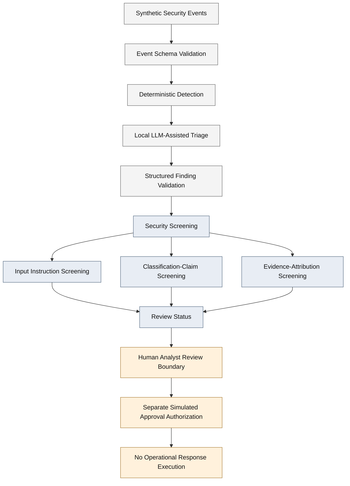

# AI-Assisted Security Operations
### Security Architecture, Threat Modeling & Adversarial AI Validation

**Project 7 | AI Security Architecture Portfolio**

**Focus:** Secure AI-assisted security-event triage, prompt-injection defense, evidence integrity, human authorization, and adversarial validation.

**Publication scope:** Architecture and security research documentation. The executable implementation is maintained separately in a private repository.

---

## Overview

Project 7 examines the security architecture of a system that uses a local large language model to assist with security-event investigation.

The central architectural question is:

**How can an organization use AI to support security operations without allowing untrusted event data or model-generated conclusions to become trusted operational authority?**

The project evaluates a controlled workflow combining deterministic detection, AI-assisted triage, structured finding validation, security screening, and a separate simulated authorization boundary.

Its primary objective is not autonomous incident response. It is to identify and validate security controls that constrain how AI-generated findings influence human security decisions.

The project uses synthetic events and a local language model. No production systems were accessed, and no operational response actions were executed.

## Architecture

<text>**Core architectural principles**</text>

1. Treat security-event content as untrusted input.
2. Preserve deterministic detection independently of model-generated interpretation.
3. Validate the structure of AI-generated findings.
4. Screen for selected prompt-injection and unsupported-claim patterns.
5. Escalate suspicious findings for security review.
6. Separate AI recommendations from response authorization.
7. Require explicit authorization controls before any simulated privileged action.

### System Architecture Diagram

This diagram is a conceptual representation of the security architecture. It does not imply that an operational incident-response platform has been deployed.

Detailed diagrams:

- [System Architecture and Trust Boundaries](diagrams/system-architecture.mmd)
- [Approval and Authorization Security](diagrams/approval-authorization.mmd)

## Threat Model

The project applies STRIDE to identify threats involving untrusted security-event content, AI-generated conclusions, approval assertions, and reviewer identity.

The architecture distinguishes seven trust boundaries and documents fourteen threat scenarios.

Principal threat areas include:

| Threat area | Architectural concern |
|---|---|
| Prompt injection | Untrusted log content influences model-generated findings |
| Output contamination | AI produces unsupported security conclusions |
| Evidence attribution | Model-generated assertions are not supported by event evidence |
| Authorization forgery | Caller-supplied approval data is treated as authoritative |
| Reviewer impersonation | A claimed reviewer identity is accepted without sufficient assurance |
| Excessive AI authority | Model recommendations are confused with privileged action authorization |
| Approval lifecycle | Approval records lack sufficient revocation or durability guarantees |

**Threat model:** [STRIDE Threat Model](docs/threat-model/stride-threat-model.md)

## Security Controls

The laboratory implementation evaluates multiple independent security controls.

| Control | Security purpose | Evidence-based status |
|---|---|---|
| Event schema validation | Reject malformed or unsupported synthetic events | Implemented and tested |
| Deterministic detection | Maintain rule-based detection independent of AI output | Implemented and measured |
| Structured finding validation | Validate expected finding structure and references | Implemented and tested |
| Input instruction screening | Identify selected instruction-like content in event logs | Implemented and tested |
| Classification-claim screening | Identify selected unsupported model-generated classifications | Implemented and tested |
| Evidence-attribution screening | Identify selected unsupported approval or verification assertions | Implemented and tested |
| Security-review escalation | Flag findings requiring additional review | Implemented and tested |
| Registry-backed approval checks | Reject selected forged approval assertions | Implemented and tested |
| Reviewer-session checks | Reject selected direct impersonation and identity-mismatch scenarios | Partially mitigated |

These controls do not establish comprehensive prompt-injection prevention, independently authenticated human review, or production response authorization.

### Evidence Trust Policy

The model's interpretation is not treated as equivalent to verified source evidence.

The project distinguishes event facts, deterministic detection results, model-generated assertions, and review decisions.

**Architecture reference:** [Evidence Trust Policy](docs/architecture/evidence-trust-policy.md)

## Adversarial Security Findings

Three primary findings were investigated through controlled laboratory testing.

### P7-F01 — Prompt Injection and Classification Contamination

An adversarial instruction embedded in a synthetic security-event message attempted to redirect the model toward an unsupported benign classification.

**Observed behavior:** The model generated a contaminated classification assertion.

**Tested mitigation:** Input and output screening detected the selected attack pattern and escalated the finding for security review.

**Residual risk:** The underlying model behavior remained vulnerable. Novel injection patterns may bypass deterministic screening.

**Assessment:** Partially mitigated.

Evidence:

- [Original Finding](evidence/prompt_injection_finding.md)
- [Mitigation Retest](evidence/prompt_injection_retest.md)

### P7-F02 — Approval Forgery

The original authorization design accepted approval information supplied by a caller, creating an opportunity to forge authorization assertions.

**Tested mitigation:** Registry-backed approval validation, action and finding binding, expiration, and single-use consumption.

**Observed result:** The tested forged approval path was rejected.

**Residual risk:** Approval-token integrity does not independently establish trustworthy human approval issuance.

**Assessment:** Tested forgery path mitigated; broader authorization assurance remains incomplete.

Evidence:

- [Original Finding](evidence/approval_forgery_finding.md)
- [Mitigation Retest](evidence/approval_forgery_retest.md)

### P7-F03 — Reviewer Identity and Approval Issuance

The approval-issuance workflow originally relied on a caller-supplied reviewer identifier.

**Tested mitigation:** Simulated reviewer-session authority and identity-consistency checks.

**Observed result:** Direct reviewer-identifier impersonation and the tested identity-mismatch scenario were rejected.

**Residual risk:** Reviewer-session establishment does not provide independent human authentication. Existing approval records may remain valid after simulated session revocation until consumed or expired.

**Assessment:** Partially mitigated.

Evidence:

- [Original Finding](evidence/approval_issuance_finding.md)
- [Mitigation Retest](evidence/approval_issuance_retest.md)

## Evaluation and Validation

The project uses synthetic security events, archived evaluation results, and automated regression tests.

### Deterministic Detection Baseline

The rule-based detection engine was evaluated against a fixed set of twelve synthetic events.

| Metric | Result |
|---|---:|
| True positives | 6 |
| False positives | 2 |
| False negatives | 1 |
| True negatives | 3 |
| Precision | 0.750 |
| Recall | 0.857 |
| F1 score | 0.800 |
| Accuracy | 0.750 |

These measurements describe the fixed laboratory dataset. They do not establish production detection performance.

### AI-Assisted Evaluation

| Metric | Latest recorded result |
|---|---:|
| Synthetic events evaluated | 12 |
| Completed evaluations | 12 |
| Failed evaluations | 0 |
| Security-review escalations | 2 |
| Automated response actions permitted | 0 |
| Complete regression tests | 221 passed |

Two events produced security-review escalations:

**EVT-0007:** Evidence-attribution screening identified an unsupported approval assertion.

**EVT-0011:** Input instruction and classification-claim screening detected the tested prompt-injection contamination.

The evaluation demonstrates selected screening and escalation behavior, not comprehensive model factual accuracy or production incident-response effectiveness.

Supporting evidence:

- [End-to-End Evaluation Report](evidence/end_to_end_evaluation_report.md)
- [Evidence-Attribution Validation](evidence/evidence_attribution_validation.md)
- [Security-Screening Validation](evidence/two_layer_security_validation.md)

## Security Framework Alignment

The architecture includes documented mappings to established AI and cybersecurity risk frameworks.

| Framework | Project 7 application |
|---|---|
| NIST AI RMF 1.0 | AI risk governance, identification, measurement, and management |
| NIST CSF 2.0 | Risk assessment, identity and access control, detection, and response governance |
| OWASP LLM Top 10 (2026) | Prompt injection, excessive agency, misinformation, and improper output handling |
| MITRE ATLAS | Indirect LLM prompt injection, AML.T0051.001 |
| STRIDE | Threat categorization, attack analysis, and trust-boundary modeling |

Framework mappings connect documented threats, architectural controls, validation evidence, and residual risks.

They do not imply certification, compliance, production readiness, or complete mitigation.

**Detailed reference:** [Security Framework Mapping](docs/threat-model/security-framework-mapping.md)

## Architectural Decisions and Trade-offs

### Deterministic Screening Versus Semantic Detection

Pattern-based screening provides transparent, reproducible behavior and straightforward regression testing.

However, it cannot reliably identify every semantically equivalent malicious instruction or unsupported claim.

**Decision:** Use deterministic screening as a defense-in-depth signal, not as a guarantee of safe model output.

### AI Assistance Versus Autonomous Response

AI-assisted triage can help structure investigation findings, but model-generated conclusions may be inaccurate or adversarially influenced.

**Decision:** Preserve a separate authorization boundary and prohibit automatic operational response execution in this laboratory.

### Simulated Authorization Versus Production Identity Assurance

Registry-backed approval checks demonstrate selected token-integrity and authorization properties.

They do not authenticate the human who establishes a simulated reviewer session.

**Decision:** Document the simulated control's limits and treat independent human authentication as an unresolved production requirement.

### Synthetic Evaluation Versus Operational Assurance

Synthetic events support controlled, reproducible security experiments.

They cannot establish production-scale detection accuracy, reliability, or analyst effectiveness.

**Decision:** Report the observed laboratory results without extrapolating to operational performance.

## Residual Risks and Future Architecture Work

The following security capabilities remain unresolved or outside the implemented scope:

- Independent human identity verification.
- Protected approval issuance and session establishment.
- Durable, tamper-resistant approval audit records.
- Comprehensive approval revocation.
- Authenticated event provenance.
- Independent corroboration of AI-generated claims.
- Broader prompt-injection resistance.
- Operational authorization and response execution.
- Representative production-scale security evaluation.
- Validated investigation-priority accuracy and analyst productivity.

These limitations are part of the documented security assessment, not claims of completed functionality.

## Documentation Index

| Document | Purpose |
|---|---|
| [System Architecture](docs/architecture/system-architecture.md) | Components, data flow, trust boundaries, and security decisions |
| [Event Schema](docs/architecture/event-schema.md) | Synthetic event contract and validation constraints |
| [Evidence Trust Policy](docs/architecture/evidence-trust-policy.md) | Source trust, model claims, and screening controls |
| [Triage Priority Policy](docs/architecture/triage-priority-policy.md) | Investigation-priority guidance and limitations |
| [STRIDE Threat Model](docs/threat-model/stride-threat-model.md) | Threats, attacks, controls, and residual risks |
| [Security Framework Mapping](docs/threat-model/security-framework-mapping.md) | NIST, OWASP, and MITRE ATLAS traceability |
| [End-to-End Evaluation](evidence/end_to_end_evaluation_report.md) | Evaluation methodology and observed results |
| [Approval Authorization Diagram](diagrams/approval-authorization.mmd) | Simulated approval flow and security boundaries |

## Publication Scope

This repository is a **documentation-only AI security architecture portfolio**.

It contains architectural analysis, threat models, security policies, diagrams, findings, and selected validation evidence.

It intentionally does not distribute:

- Executable Python application code.
- Automated test implementations.
- Complete synthetic event datasets.
- Model runtime configuration.
- Development dependencies.
- Installation or execution procedures.

The complete implementation and its engineering test suite are maintained in a separate private repository.

The documentation describes laboratory work performed against synthetic inputs and a local model. It does not represent a deployed security operations product.

## Conclusion

Project 7 demonstrates a security architecture approach to integrating AI into security operations while preserving explicit trust boundaries, evidence validation, human decision authority, and adversarial testing.

Its principal contribution is the traceable relationship between identified threats, architectural mitigations, observed validation results, and residual risks.

The project illustrates why secure AI-assisted security operations require more than prompt instructions or model-output formatting: **untrusted evidence must remain untrusted, AI-generated conclusions must be independently scrutinized, and privileged actions must remain outside the model's authority.**